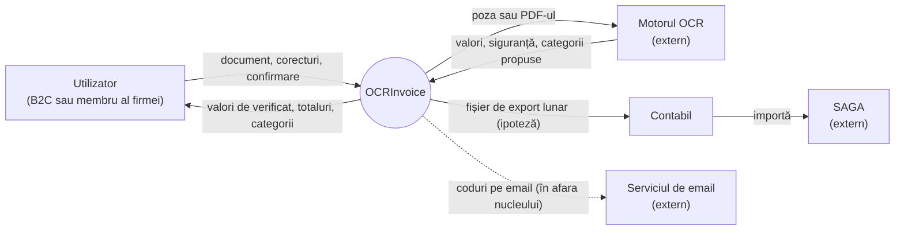

# Limitele sistemului

## Nucleul

Analiza urmărește drumul unui document:

încărcare → extragere → verificare și corecție → confirmare → categorisire sau export

| Pas | Utilizatorul | Sistemul | Sistemul extern |
|-----|--------------|----------|-----------------|
| Încărcare | Fotografiază documentul sau alege o poză ori un PDF | Acceptă doar imagini și PDF-uri | Nu intervine |
| Extragere | Așteaptă și vede în ce etapă e citirea | Trimite documentul la motorul OCR, arată cum avansează și spune dacă a eșuat | Motorul OCR întoarce valorile, fiecare cu un grad de siguranță |
| Verificare și corecție | Corectează valorile marcate | Marchează valorile nesigure și compară produsele adunate cu totalul | Nu intervine |
| Confirmare | Cere salvarea | O permite doar dacă nu mai e nimic de verificat și totalul se potrivește. Documentul intră în evidență, cu poza atașată | Nu intervine |
| Categorisire | Poate schimba categoria unui produs (când anume, vezi Q-06) | Fiecare produs are o categorie, iar sumele pe categorii se recalculează | Categoria o propune motorul OCR |
| Export (B2B, ipoteză) | Cere exportul pe o lună (sau se face automat, vezi Q-04) | Face fișierul cu documentele confirmate ale firmei | Contabilul importă fișierul în SAGA |

Tot în nucleu intră corectarea unui document deja confirmat și ștergerea lui.

## Diagrama de context

Linia punctată duce la un sistem extern pe care îl folosim în afara nucleului.

## Ce există, dar nu intră în nucleu

Le pomenim, dar nu le modelăm în detaliu.

| Ce | De ce rămâne în afara nucleului |
|----|---------------------------------|
| Contul: crearea, codul pe email, intrarea, sesiunea păstrată, resetarea parolei, deconectarea, numele | E o condiție de dinainte, adică există un utilizator identificat. Nu ține de drumul documentului |
| Contul de firmă (ipoteză) | Ne interesează doar că documentul e al firmei, nu al persoanei (I-04) |
| Cheltuiala manuală | E un document care nu trece prin încărcare, extragere și verificare |
| Consultarea: lista lunii pe zile, totalul și comparația cu luna trecută, detaliul, filtrul după tip, categoriile lunii | Doar citește documente confirmate |
| Ștergerea contului | Pentru documente contează doar că dispar definitiv |
| Limba aplicației (română sau engleză) | Nu schimbă comportamentul |

## Ce nu face sistemul

| Ce | De ce |
|----|-------|
| Împărțirea unui bon între mai multe persoane | Nu e cerută |
| Încărcarea mai multor documente deodată | Nu e cerută. Fiecare document trece singur prin nucleu |
| Folosirea fără internet | Nu e cerută. Fără server, utilizatorul află doar că serverul nu răspunde |
| Legătura directă cu programe de contabilitate | Sistemul face un fișier, nu trimite date (I-01) |
| Mai multe monede | Totul e în lei (I-07) |
| Bugete și alerte de cheltuieli | Nu sunt cerute |

## Sistemele externe

| Sistem | Ce primește | Ce întoarce | Ce poate merge prost | Ce depinde de noi |
|--------|-------------|-------------|----------------------|-------------------|
| Motorul OCR | Poza sau PDF-ul | Magazinul, data, ora, totalul, plata și fiecare produs cu categoria lui. Fiecare valoare are o siguranță între 0 și 1 | Nu răspunde, răspunde greu, nu poate citi documentul sau dă valori greșite cu siguranță mare | Nu controlăm ce face înăuntru. Alegem ce trimitem, cât așteptăm și ce facem cu rezultatul |
| SAGA (ipoteză) | Fișierul de export, prin contabil | Nimic, nu ne răspunde | Nu acceptă formatul sau contabilul importă aceleași documente de două ori | Doar ce punem în fișier și în ce format |
| Serviciul de email | Codurile de confirmare și de resetare a parolei | Nimic | Emailul întârzie sau nu ajunge | Doar textul și cât timp e valabil codul |
