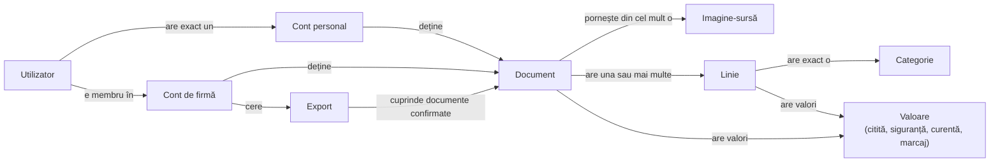

# Concepte, identitate și relații

Pentru fiecare concept spunem ce îl identifică, adică după ce hotărâm că două apariții sunt același
lucru. Deciziile D-xx și alternativele lor sunt în
[04-distinctii-si-alternative.md](04-distinctii-si-alternative.md).

## Privire de ansamblu

Schița arată relațiile dintre concepte. Nu e o diagramă de clase.

## Concepte cu identitate

Două apariții cu aceeași identitate sunt același lucru, chiar dacă restul s-a schimbat între timp.

| Concept | Ce îl identifică | Ce se poate schimba fără să devină altceva | Etichetă |
|---------|------------------|--------------------------------------------|----------|
| Utilizator | Adresa de email | Numele, parola | Stabilit (CF-11) |
| Cont | Un identificator dat de sistem la creare | Membrii unui cont de firmă | Propunere AI (D-01) |
| Document | Un identificator dat de sistem la încărcare sau la scriere | Toate valorile, liniile, starea | Propunere AI (D-02) |
| Imagine-sursă | Documentul din care face parte | Nimic. Nu se schimbă | Propunere AI (D-03) |
| Linie | Documentul și poziția ei în document | Denumirea, suma, categoria | Propunere AI (D-05) |
| Export | Contul de firmă, luna și momentul generării | Nimic. Conținutul rămâne cel de la generare | Propunere AI (D-09) |

## Concepte fără identitate (valori)

Două valori egale sunt interschimbabile. Nu au istoric propriu.

| Concept | Valori posibile | De ce e valoare | Etichetă |
|---------|-----------------|-----------------|----------|
| Categorie | Una din 9, fixe | Lista nu se schimbă, iar utilizatorul nu creează categorii | Stabilit (R-04) |
| Tipul documentului | Bon, factură, chitanță, cheltuială adăugată manual | E doar o etichetă folosită la filtrare | Stabilit (CF-14) |
| Plata | Numerar, card, transfer | Listă fixă | Stabilit (CF-13) |
| Magazin | Un text | Nicio cerință nu grupează documentele după magazin | Propunere AI (D-06) |
| Sumă | Lei, cu cel mult două zecimale | O singură monedă (I-07) | Stabilit (R-06) |
| Lună | An și lună calendaristică | Rezultă din data documentului | Stabilit (CN-02) |
| Siguranță | Un număr între 0 și 1 | Vine odată cu valoarea citită | Stabilit (CF-02) |
| Marcaj | De verificat, corectat, confirmat sau niciunul | Descrie o valoare, nu există separat | Stabilit (CF-04), „confirmat” e Propunere AI (P-04) |

## Relațiile

| ID | Relația | Câte | Etichetă |
|----|---------|------|----------|
| REL-01 | Utilizatorul are un cont personal | Exact unul. Contul personal are exact un utilizator | Stabilit (R-01) |
| REL-02 | Utilizatorul e membru într-un cont de firmă | Zero sau unul. Contul de firmă are cel puțin un membru | Ipoteză (QD-05) |
| REL-03 | Documentul aparține unui cont | Exact unul, stabilit la creare. Nu se mută | Stabilit (R-01, CF-12). „Nu se mută” e Propunere AI |
| REL-04 | Documentul scanat pornește dintr-o imagine-sursă | Exact una. Cheltuiala manuală nu are | Stabilit (CF-01, CF-13) |
| REL-05 | Documentul are linii | Una sau mai multe. Cheltuiala manuală are exact una | Propunere AI (D-07, QD-04) |
| REL-06 | Linia are o categorie | Exact una, implicit Altele | Stabilit (R-04, CF-07) |
| REL-07 | Exportul cuprinde documente | Documentele confirmate ale firmei cu data în luna cerută, așa cum erau la generare | Ipoteză (I-02), D-09 |
| REL-08 | Documentul ține minte cine l-a încărcat | Un utilizator. E o informație, nu un drept de proprietate | Propunere AI |

REL-08 nu e cerută în Faza 1. O propunem pentru că I-04 lasă orice membru să corecteze sau să
șteargă documentele firmei, iar firma ar putea vrea să știe cine a adus un document.

## Ce valori are un document

| Valoare | Document scanat | Cheltuială manuală | Are siguranță și marcaj |
|---------|-----------------|--------------------|-------------------------|
| Tipul | Bon, factură sau chitanță | Cheltuială adăugată manual | Nu (vezi D-11) |
| Magazin | Citit | Nu are | Da |
| Data | Citită | Scrisă de utilizator, cel târziu azi | Da, la cel scanat |
| Ora | Citită | Nu are (R-07) | Da |
| Totalul | Citit | Egal cu suma singurei linii | Da, la cel scanat |
| Plata | Citită | Scrisă de utilizator | Da, la cel scanat |
| Nota | Opțională | Opțională | Nu |
| Denumirea liniei | Citită | „Pentru ce a plătit” | Da, la cel scanat |
| Suma liniei | Citită | Scrisă de utilizator | Da, la cel scanat |
| Categoria liniei | Propusă de motorul OCR | Aleasă de utilizator | Nu (ipoteză, QD-07) |

Că un document scanat poate avea o notă e o ipoteză a noastră: CF-08 pomenește nota la corectare,
fără să spună pentru ce tip de document.

## Ce ține minte o valoare

O valoare a unui document scanat are patru părți (D-04):

| Parte | Ce e | Se schimbă? |
|-------|------|-------------|
| Valoarea citită | Ce a întors motorul OCR | Nu |
| Siguranța | Cât de sigur a fost motorul OCR | Nu |
| Valoarea curentă | La început, cea citită. După o corectare, cea pusă de utilizator | Da |
| Marcajul | Vezi tabelul de mai jos | Da |

| Marcaj | Când apare | Blochează confirmarea | Etichetă |
|--------|------------|-----------------------|----------|
| Niciunul | Siguranța e cel puțin 0,8 și utilizatorul n-a atins valoarea | Nu | Stabilit (R-02) |
| De verificat | Siguranța e sub 0,8 și utilizatorul n-a atins valoarea | Da | Stabilit (R-02, R-03) |
| Corectat | Utilizatorul a schimbat valoarea curentă | Nu | Stabilit (CF-04) pentru valorile marcate. Pentru cele nemarcate e Propunere AI |
| Confirmat | Utilizatorul a acceptat o valoare „de verificat” fără s-o schimbe | Nu | Propunere AI (P-04, răspuns la Q-07) |

Valorile unei cheltuieli manuale nu au valoare citită, siguranță sau marcaj. Le-a scris utilizatorul.

## Starea documentului

Numele stărilor vin din planul echipei. Tranzițiile dintre ele le stabilește Faza 3.

| Stare | Ce înseamnă în domeniu | E în evidență |
|-------|------------------------|---------------|
| Încărcat | Există imaginea-sursă, dar încă nu a fost trimisă la citire | Nu |
| În procesare | Motorul OCR citește imaginea | Nu |
| De verificat | Valorile au fost citite, iar utilizatorul nu a confirmat încă | Nu |
| Confirmat | Utilizatorul a confirmat, iar regulile RD-04 și RD-05 sunt respectate | Da |
| Eroare | Citirea a eșuat sau nu s-a terminat la timp (I-09) | Nu |

În domeniu, un document există de la încărcare, nu doar de la confirmare (D-10). Dacă sistemul îl
păstrează pe server sau doar pe telefon până la confirmare rămâne întrebarea Q-01, pentru Faza 3.
O cheltuială manuală intră direct în starea Confirmat.
