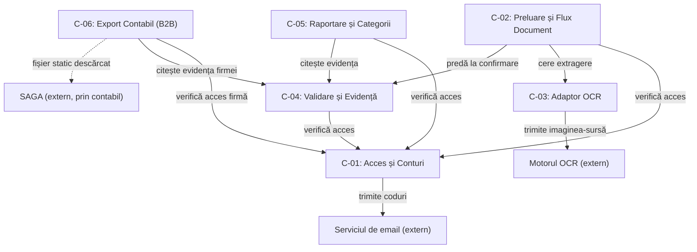

# Responsabilități și componente logice

Împărțim sistemul în 6 componente logice, fiecare cu o responsabilitate bine delimitată. O componentă
logică nu este o clasă din implementare, un tabel sau o tehnologie, ci o unitate de responsabilitate
derivată din cerințele din [../01-problema/](../01-problema/) și conceptele din
[../02-domeniu/](../02-domeniu/).

## Cele 6 componente logice

| ID | Componentă | Responsabilitate principală | Surse și etichetă | Depinde de |
|----|------------|-----------------------------|-------------------|------------|
| `C-01` | Acces și Conturi | Autentificare, confirmare email (`RD-13`), resetare parolă (`CN-05`), verificare acces pe cont personal sau de firmă (`RD-02`), ștergere definitivă cont (`CF-16`). | `Stabilit`: `CF-11`, `CF-12`, `CN-01` (`Ipoteză` pentru contul de firmă: `I-04`) | Serviciul de email (extern) |
| `C-02` | Preluare și Flux Document | Primește poză sau PDF (`CF-01`), păstrează `imaginea-sursă` imuabilă (`D-03`), creează documentul cu identificator propriu (`D-02`, `REL-03`, `REL-08`), coordonează trimiterea la OCR și progresul în 4 etape (`CF-03`), gestionează tranzițiile și corecțiile ciornei până la confirmare. | `Propunere AI`: `DP-01` (bazat pe `CF-01`, `CF-03`, `D-03`, `D-10`) | `C-01`, `C-03`, `C-04` |
| `C-03` | Adaptor OCR | Apelează motorul OCR extern, aplică limita de timp (`I-09`), normalizează valorile întoarse, aplică marcajul `de verificat` pentru siguranță `< 0,8` (`RD-03`) și categoria implicită `Altele` dacă lipsește (`RD-06`). | `Propunere AI` (bazat pe `CF-02`, `CF-03`, `I-09`, `RD-03`, `RD-06`) | Motorul OCR (extern) |
| `C-04` | Validare și Evidență | Păstrează documentele confirmate (evidența, `RD-07`) și cheltuielile manuale (`D-07`, `CF-13`), impune regulile de validare (`RD-04`, `RD-05`, `RD-10`, `RD-11`), validează atomic corecțiile după confirmare (`DP-02`) și semnalează posibile duplicate la confirmare (`P-02`, `DP-05`). | `Stabilit`: `CF-06`, `CF-08`, `CF-09` (cu `DP-02`, `DP-05` ca `Propunere AI`) | `C-01` |
| `C-05` | Raportare și Categorii | Calculează lista lunii pe zile, detaliul unui document, filtrarea după tip (bon, factură, chitanță, cheltuială adăugată manual), totalul lunii față de luna trecută (`RD-08`, `CN-02`) și sumele/procentele pe cele 9 categorii (`RD-09`). | `Stabilit`: `CF-14`, `CF-15` | `C-01`, `C-04` |
| `C-06` | Export Contabil (B2B) | Selectează documentele confirmate ale firmei dintr-o lună calendaristică (`RD-12`), generează fișierul static pentru SAGA cu momentul generării (`D-09`), marchează documentele incluse cu `exportat în {lună}` (`P-01`, `DP-03`). | `Ipoteză`: `CF-10`, `I-01`–`I-03` (cu `DP-03`, `DP-04` ca `Propunere AI`) | `C-01`, `C-04` |

## Detalierea responsabilităților

### `C-01: Acces și Conturi`

- Gestionează identitatea utilizatorului (`CF-11`), confirmarea adresei de email (`RD-13`) și
  resetarea parolei prin coduri de unică folosință păstrate ireversibil (`CN-05`).
- Verifică apartenența utilizatorului la contul personal (`REL-01`) sau la contul de firmă
  (`REL-02`, `I-04`), astfel încât orice altă componentă să poată impune izolarea între conturi
  (`RD-02`, `INV-02`).
- Inițiază ștergerea definitivă a contului, sesiunilor și documentelor aferente după confirmare
  (`CF-16`).
- Nu cunoaște structura liniilor, regulile de totalizare sau formatul exportului.

### `C-02: Preluare și Flux Document`

- Primește fișierul încărcat (poză sau PDF, `CF-01`) și `cheie_idempotenta` (`CN-04`, `OP-01`),
  păstrează `imaginea-sursă` fără a o modifica vreodată (`D-03`, `INV-06`) și creează documentul în
  starea `Încărcat` (`D-10`, `DP-01`).
- Trimite imaginea spre `C-03`, expune progresul în cele 4 etape (`CF-03`), tratează trecerea în
  `De verificat` sau `Eroare` (`OP-02`) și permite reîncercarea citirii fără reîncărcarea imaginii
  (`TR-05`).
- Permite corectarea valorilor și acceptarea valorilor nesigure (`P-04`) cât timp documentul este
  în `De verificat` (`OP-03`, `TR-06`).
- Predă documentul către `C-04` abia în momentul confirmării (`OP-04`, `TR-07`). Documentele din
  `C-02` nu intră în evidență (`RD-07`, `INV-05`).

### `C-03: Adaptor OCR`

- Singura componentă care comunică cu Motorul OCR extern (detaliat în
  [02-granite-sisteme-externe.md](02-granite-sisteme-externe.md)).
- Aplică limita de timp (`I-09`) și traduce eșecurile externe (indisponibilitate, timeout, document
  ilizibil) într-un rezultat uniform de eșec pentru `C-02`.
- Normalizează valorile citite, aplică regula pragului de `0,8` (`RD-03`, `I-08`) pentru marcajul
  `de verificat` și atribuie categoria implicită `Altele` liniilor fără categorie propusă (`RD-06`).
- Nu păstrează documente și nu decide dacă un document poate fi confirmat.

### `C-04: Validare și Evidență`

- Singura poartă de intrare în evidența contului (`RD-07`, `INV-05`), atât pentru documentele
  scanate confirmate venite din `C-02` (`OP-04`), cât și pentru cheltuielile manuale (`CF-13`,
  `D-07`, `TR-09`).
- Impune invarianții de integritate: zero marcaje `de verificat`, `totalul documentului == suma
  liniilor` la ban (`RD-04`, `RD-05`, `I-10`, `INV-03`), sume `> 0` cu cel mult 2 zecimale,
  categorie din lista de 9 și `data documentului <= azi` (`RD-06`, `RD-10`, `INV-04`).
- Gestionează corectarea atomică a documentelor deja confirmate (`CF-08`, `OP-03`, `DP-02`) și
  ștergerea definitivă cu confirmare explicită (`CF-09`, `RD-11`, `OP-05`).
- Semnalează posibilele duplicate (același magazin, dată și total în același cont) la confirmare,
  fără a bloca salvarea în evidență (`P-02`, `DP-05`).

### `C-05: Raportare și Categorii`

- Oferă exclusiv operații de citire peste evidența păstrată de `C-04`: lista lunii grupată pe zile
  cu subtotal zilnic, detaliul unui document, filtrarea după tip (`CF-14`), totalul lunii comparat
  cu luna precedentă și distribuția pe cele 9 categorii ordonată descrescător (`CF-15`, `RD-09`).
- Grupează documentele după `data documentului` în fusul orar al utilizatorului (`RD-08`, `CN-02`).
- Nu citește niciodată din `C-02`, garantând structural că documentele neconfirmate nu intră în
  totaluri (`RD-07`, `INV-05`).

### `C-06: Export Contabil (B2B)`

- Disponibil exclusiv pentru conturi de firmă (`I-03`, `CF-10`).
- Citește din `C-04` documentele `Confirmat` ale firmei din luna calendaristică cerută (`RD-12`,
  `EA-05`), generează fișierul static pentru SAGA (`I-01`, `DP-04`) și păstrează `Export`-ul cu
  momentul generării fără a-i mai modifica ulterior conținutul (`D-09`, `INV-06`).
- Marchează documentele incluse cu `exportat în {lună}` (`P-01`, `DP-03`) pentru a putea semnala
  eventuale modificări ulterioare (`Q-03`).

## Diagrama de dependențe

Săgețile indică direcția dependenței („folosește / depinde de”). Graful nu conține cicluri.

Linia punctată dintre `C-06` și `SAGA` arată că nu există apel direct de rețea: contabilul descarcă
fișierul și îl importă manual (`I-01`).

## Justificarea granițelor (coeziune și cuplare)

1. **Izolarea sistemelor externe (`C-03`, `C-06` și `C-01`).** Nicio componentă de evidență sau
   raportare nu depinde de Motorul OCR, de formatul SAGA sau de serviciul de email. De exemplu, dacă
   schimbăm pragul de siguranță de la `0,8` la `0,9` (schimbarea `S-02`) sau înlocuim motorul OCR,
   modificarea rămâne localizată în `C-03`, fără să atingă `C-04`, `C-05` sau `C-06`. La fel, dacă
   documentația SAGA (`Q-04`) impune un alt format de fișier, modificăm doar `C-06`.
2. **Separarea ciornei de evidență (`C-02` vs. `C-04`).** Documentele aflate în `Încărcat`,
   `În procesare`, `De verificat` sau `Eroare` pot avea valori incomplete, marcaje `de verificat` și
   diferențe de sumă. Păstrându-le în `C-02` și trecându-le în `C-04` abia după validarea din
   `OP-04`, `C-04` devine singura componentă care garantează `INV-03` și `INV-05`. Dacă toate stările
   ar fi amestecate într-un singur modul, fiecare interogare de total sau export ar trebui să filtreze
   manual ciornele, crescând riscul de erori.
3. **Raportarea strict peste evidență (`C-05`).** `C-05` depinde doar de `C-01` și `C-04` și nu are
   vizibilitate asupra `C-02`. Astfel, regula `RD-07` (doar documentele confirmate apar în liste și
   totaluri) este impusă prin structura dependențelor, nu doar prin atenția programatorilor.
4. **Absența ciclurilor de dependență.** Componentele pot fi ordonate strict pe niveluri:
   sisteme externe → `C-01` și `C-03` → `C-04` → `C-02`, `C-05`, `C-06`. Nu există dependență inversă
   de la `C-04` către `C-02`, `C-05` sau `C-06`, ceea ce permite verificarea separată a regulilor de
   evidență fără a aduce în discuție OCR-ul sau exportul contabil.

