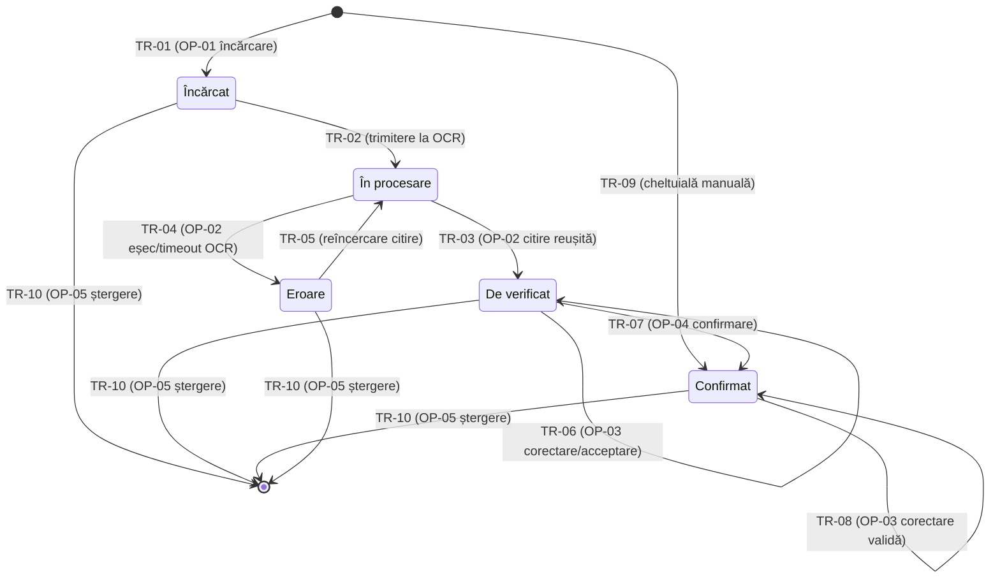

# Stări și tranziții ale documentului

Folosim exact cele 5 stări stabilite în [../02-domeniu/02-concepte-si-relatii.md](../02-domeniu/02-concepte-si-relatii.md):
`Încărcat`, `În procesare`, `De verificat`, `Confirmat` și `Eroare`. Doar starea `Confirmat` face
parte din evidență (`RD-07`, `INV-05`).

## Diagrama de stări

## Tranziții permise (`TR-01`–`TR-10`)

| ID | Din starea | În starea | Operație / Eveniment | Condiție (gardă) | Efect și observații |
|----|------------|-----------|----------------------|------------------|---------------------|
| `TR-01` | *(Inexistent)* | `Încărcat` | `OP-01` (încărcare fișier) | Utilizator cu acces în cont (`INV-02`); fișier imagine sau PDF (`CF-01`). | Documentul este creat în `C-02` cu `imaginea-sursă` imuabilă (`D-03`, `INV-06`), în afara evidenței (`DP-01`). |
| `TR-02` | `Încărcat` | `În procesare` | Trimitere la Motorul OCR (`C-02` → `C-03`) | Documentul are `imaginea-sursă` atașată (`REL-04`). | Începe raportarea progresului în 4 etape (`CF-03`); documentul rămâne în afara evidenței. |
| `TR-03` | `În procesare` | `De verificat` | `OP-02` (citire OCR reușită) | `C-03` a primit și normalizat răspunsul înainte de timeout (`I-09`). | Se stabilesc valorile citite, valorile curente (`D-04`), marcajele `de verificat` sub `0,8` (`RD-03`), categoria implicită `Altele` (`RD-06`) și diferența de total (`CF-05`). |
| `TR-04` | `În procesare` | `Eroare` | `OP-02` (timeout / ilizibil / serviciu indisponibil) | Timeout depășit (`I-09`), eroare OCR sau document ilizibil (`EA-04`). | `Imaginea-sursă` rămâne păstrată (`CN-03`, `INV-06`); evidența rămâne neschimbată (`INV-05`). |
| `TR-05` | `Eroare` | `În procesare` | Reîncercare citire (`C-02` → `C-03`) | Utilizatorul cere reîncercarea (`CF-03`); `imaginea-sursă` există. | Reia citirea fără reîncărcarea fișierului și repornește cele 4 etape de progres. |
| `TR-06` | `De verificat` | `De verificat` | `OP-03` (corectare sau acceptare câmp) | Utilizator cu acces (`INV-02`); valorile noi respectă `INV-04`. | Păstrează `valoarea citită` și `siguranta` (`D-04`); schimbă marcajul în `corectat` (`CF-04`) sau `confirmat` (`P-04`); recalculează diferența de total (`CF-05`). |
| `TR-07` | `De verificat` | `Confirmat` | `OP-04` (confirmare document) | Zero marcaje `de verificat`, cel puțin o linie (`QD-04`), `INV-04` și `totalul documentului == suma liniilor` la ban (`INV-03`). | Documentul intră în evidență (`C-04`, `INV-05`, `EA-01`), actualizează totalurile lunii și ale categoriilor și avertizează la posibil duplicat (`P-02`, `DP-05`). |
| `TR-08` | `Confirmat` | `Confirmat` | `OP-03` (corectare după confirmare) | Utilizator cu acces (`INV-02`); modificarea păstrează atomic `INV-03` și `INV-04` (`DP-02`). | Actualizează evidența, totalurile și categoriile (`CF-08`, `ED-05`); dacă era exportat, adaugă marcajul `modificat după export` (`P-01`, `DP-03`). |
| `TR-09` | *(Inexistent)* | `Confirmat` | Adăugare cheltuială manuală (`C-04`) | Utilizator cu acces (`INV-02`); date valide conform `RD-10` / `INV-04` (sumă `> 0`, cel mult 2 zecimale, categorie din cele 9, `data <= azi`). | Document cu o singură linie, fără `imagine-sursă` și fără oră (`D-07`, `R-07`, `ED-07`), intră direct în evidență (`INV-05`). |
| `TR-10` | `Încărcat`, `De verificat`, `Confirmat` sau `Eroare` | *(Șters definitiv)* | `OP-05` (ștergere document) | Utilizator cu acces (`INV-02`) și confirmare explicită (`RD-11`); starea este diferită de `În procesare`. | Dispar definitiv documentul, liniile și `imaginea-sursă` (`RD-11`); dacă era `Confirmat`, iese din evidență și se recalculează totalurile (`CF-09`). |

## Tranziții interzise

| Din starea | În starea | De ce este interzisă | Invariant / Regulă încălcată |
|------------|-----------|----------------------|------------------------------|
| `Eroare` | `Confirmat` | Documentul nu are valori extrase și verificate; ar introduce un document gol sau corupt în evidență. | `INV-03`, `RD-05`, `CF-06` |
| `Încărcat` | `Confirmat` | Documentul scanat nu a trecut prin extragere OCR și verificare. | `INV-03`, `CF-02`, `CF-06` |
| `În procesare` | `Confirmat` | Citirea OCR este în curs, valorile nu sunt încă disponibile pentru verificare. | `INV-03`, `CF-03`, `CF-06` |
| `De verificat` | `Confirmat` *(cu diferență de sumă sau marcaj `de verificat`)* | Încalcă direct regula de potrivire la ban sau lasă valori nesigure neverificate. | `INV-03`, `RD-04`, `RD-05`, `EA-02`, `EA-03` |
| `Confirmat` | `De verificat` | Un document confirmat nu revine în ciornă; o corectare care strică totalul este respinsă atomic (vezi secțiunea următoare). | `DP-02`, `Q-02`, `INV-05` |
| `În procesare` | *(Șters definitiv)* | Evită conflictul cu răspunsul asincron aflat în curs de la Motorul OCR; utilizatorul așteaptă trecerea în `De verificat` sau `Eroare`. | `OP-05`, integritatea fluxului din `C-02` |
| `De verificat` / `Confirmat` | `Încărcat` | `Imaginea-sursă` a unui document nu se înlocuiește (`D-03`, `INV-06`); o altă poză creează un document nou (`D-02`). | `INV-06`, `D-02`, `D-03` |

## Alegerea pentru `Q-02`: validare atomică în `Confirmat` vs. întoarcerea în `De verificat`

Întrebarea `Q-02` cere să decidem ce se întâmplă când o corectare asupra unui document `Confirmat`
strică potrivirea dintre `totalul documentului` și `suma liniilor`. Propunerea noastră (`DP-02`,
`Propunere AI`) este **validarea atomică în starea `Confirmat`** (`TR-08`):

- **Exemplu concret:** Presupunem că bonul din `EA-01` (`25,68 lei`, cu trei linii: `LAPTE 1,5%`
  `14,98 lei`, `PÂINE` `4,50 lei`, `DETERGENT` `6,20 lei`) este deja `Confirmat` în evidența lui
  Andrei, iar totalul lui noiembrie este `425,68 lei`. Andrei observă că `DETERGENT` a fost `9,20 lei`
  și totalul real al bonului a fost `28,68 lei`. Dacă trimite din greșeală doar schimbarea liniei
  `DETERGENT` la `9,20 lei`, fără să ajusteze și `Total` la `28,68 lei`:
  - **Cu varianta aleasă (validare atomică, `DP-02`):** `C-04` respinge modificarea incompletă, îi
    arată lui Andrei diferența de `3,00 lei` și păstrează documentul în `Confirmat` cu valorile vechi
    (`25,68 lei`). Când Andrei trimite împreună `DETERGENT = 9,20 lei` și `Total = 28,68 lei`,
    `INV-03` rămâne adevărat, corectarea este acceptată atomic (`TR-08`), iar totalul lui noiembrie
    trece curat de la `425,68 lei` la `428,68 lei`.
  - **Cu alternativa respinsă (întoarcerea în `De verificat`):** la prima încercare greșită, bonul
    ar ieși din evidență (`RD-07`), totalul lui noiembrie ar scădea brusc la `400,00 lei`, iar dacă
    Andrei ar închide aplicația înainte să reconfirme, un bon deja confirmat ar dispărea din rapoarte
    și, în cazul B2B, din exportul lunii (`EA-05`).

Alegerea păstrează stabilitatea evidenței și elimină riscul ca o eroare de tastare să scoată
involuntar un document confirmat din totaluri. Rămâne etichetată `Propunere AI` până la acordul
echipei.

